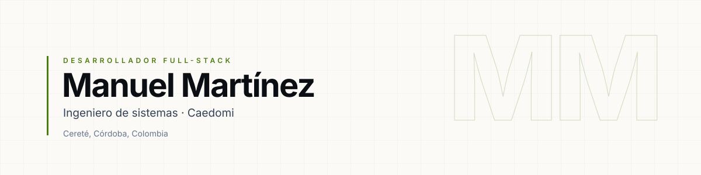

<picture>
  <source media="(prefers-color-scheme: dark)" srcset="https://raw.githubusercontent.com/ManuMartinez-u/ManuMartinez-u/main/assets/banner-dark.svg?v=3">
  
</picture>

 

Construyo productos web de punta a punta: interfaz, datos y despliegue.

 

<table>
  <tr>
    <td width="60%" valign="top">
      <h3>01 · Perfil</h3>
      
Desarrollador full-stack e ingeniero de sistemas, en Cereté, Córdoba. Hoy trabajo en <strong>Caedomi</strong>, construyendo una plataforma de comercio electrónico: catálogo, checkout y paneles de administración y vendedores.

      
Antes: <strong>ProCreditos</strong>, app móvil de gestión de créditos.

    </td>
    <td width="40%" valign="top">
      <h3>02 · Stack</h3>
      
<strong>Lenguajes</strong> 
      TypeScript · JavaScript · HTML · CSS

      
<strong>Frontend</strong> 
      Next.js · React · React Native

      
<strong>Datos e infraestructura</strong> 
      Node.js · API REST · Docker

    </td>
  </tr>
</table>

 

  

